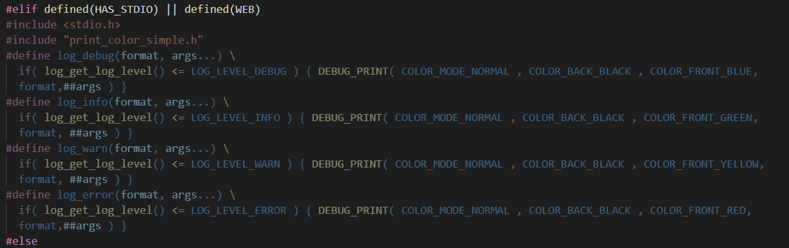

# awtk移植说明

支持AK37E芯片SDK V1.03以及以上正式版本，发布时间2021年12月02日，主要修改点如下：
## 1、src/platforms移植
* 【新增】platforms目录下添加alios子目录并实现相关文件，适配alios系统
* 【修改】1、platforms部分代码拷贝到awtk-xx-fb/awtk-port-ak目录下，并在awtk-port-ak目录下的SConscript脚本中添加对platforms的编译
         2、src目录下SConscript脚本中tkc_static(V1.7)或tkc_core(V1.7.1)库名称改为tkc；同时TK_SOURCES源码只保留'tkc/*.c'，删除'platforms/pc/*.c'
        platforms部分代码放到awtk-xx-fb中去编译，这样方便不同系统平台共用一份SConscript脚本;
        注释掉对EXT_WIDGETS_SOURCES的编译????

## 2、src/tkc/log.h移植
* 【新增】src目录下新增print_color_simple.h头文件，添加DEBUG_PRINT和DEBUG_VAL宏定义，实现(带颜色、文件名、函数名、代码行的)调试
         log信息输出
* 【优化】log.h中#elif defined(HAS_STDIO) || defined(WEB)下的log_debug、log_info、log_warn、log_error宏定义都使用DEBUG_PRINT来
          替换，这样既保留了awkt中对log_level的分级设置功能，也可以实现不同等级调试信息区分颜色输出

## 3、anyka平台TDE硬件加速功能适配
* 【新增】awtk-linux-fb/awtk-port-ak/下新增anyka_g2d.c和anyka_g2d.h文件，使用37e的tde实现了
        g2d_fill_rect(填充指定区域)、
        g2d_copy_image(图片复制)、
        g2d_blend_image(图片混合)、
        g2d_rotate_image(图片旋转)
这几个接口在src/blend/image_g2d.c中被调用，awkt已经实现了纯软件的图形填充、复制、混合、拷贝算法，这里的移植是使用37e的tde硬件来完成相应的操作，提升awkt的UI绘制效率

* 【修改】application/gui/awtk/awtk/src/blend/image_g2d.c中添加硬件加速接口的使用适配

## 4、src/graphic_buffer/graphic_buffer_default.c移植
* 【优化】1、添加WITH_G2D宏定义，并使用anyka平台dma内存申请接口替换awtk的默认内存申请接口
*        2、[2023-9-19]优化size计算方式，使用平台提供的dma方式申请时肯定是返回32字节对齐地址，所以size可以不加32
*        ，否则每缓存一张图片就会浪费32字节的dma空间。
*        3、[2023-9-19]graphic_buffer_default_create中申请dma空间失败时主动调用image_manager_unload_unused去释放超过1s未使用的图片，
*        解决因为图片反复释放和申请导致dma内存碎片而出现剩余内存足够但是缺申请不到合适内存空间问题。
* 【修改】将graphic_buffer_default_t类型定义放到graphic_buffer.h头文件中去，因为在anyka_g2d.c中还需要使用这个类型

## 5、src/awtk_main.inc移植
* 【修改】屏蔽log_set_log_level接口的使用，方便main中在启动awtk之前通过log_set_log_level设置打印等级，否则main中设置的打印等级会被被覆盖掉。在main中修改的好处是可以读取配置文件中的打印等级设置，做到动态修改的效果。

## 6、src/ubjson/SConscript修改
* 【修改】屏蔽env.Program相关调用，该调用会生成执行文件而立即链接相关库，而RTOS平台是在编译工作完成后再进行链接，方式的差异导致RTOS平台编译失败，此处为tools类应用，实际产品中无需使用，可屏蔽。

## 7、新增资源打包工具
* 【新增】awtk/下新增bin目录及该目录下的资源的打包工具相关文件，可使用相关工具在编译时调用相关脚本实现资源打包功能；

## 8、修改canvas_offline.inc，支持RTOS平台创建RGB888或BGR888格式离线画布
* 【修改】修改awtk/src/base/canvas_offline.inc文件，定义宏#define LINUX，支持RTOS平台创建RGB888或BGR888格式离线画布；
  
## 9、anyka平台vdec硬件解码器功能适配
* [2023-9-26]awtk_global.c文件tk_init_internal函数中添加WITH_ANYKA_VDEC宏定义内容，注册vdec图片加载器，对应的加载器实现源码在awtk-linux-fb/awtk-port-ak/image_loader_anyka_vdec.c文件中